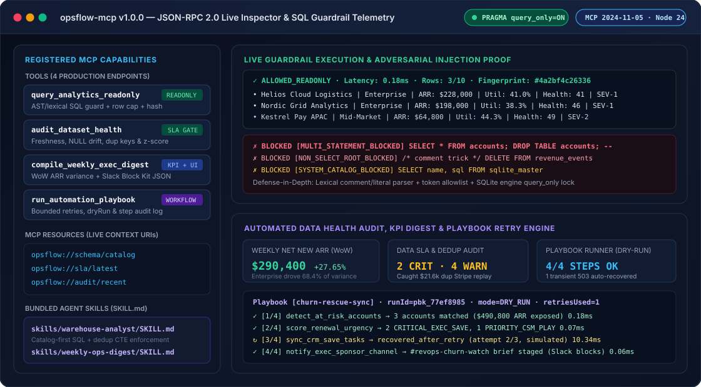
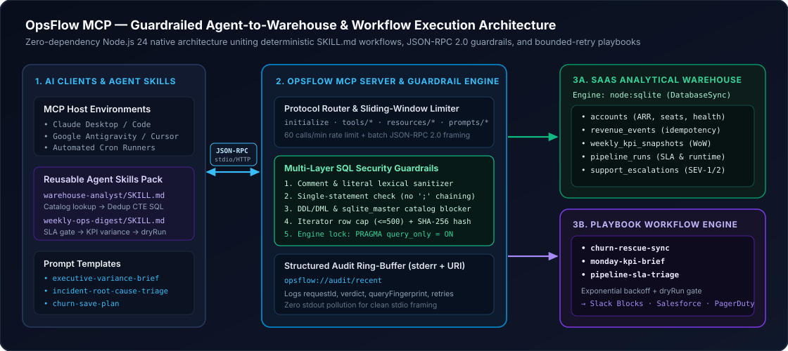

# OpsFlow MCP

**Production Model Context Protocol (MCP) Server, Guardrailed SQL Analytics Tools, Reusable Agent Skills & Automated Ops Workflow Engine**

[](https://github.com/Nasim-U/opsflow-mcp/actions/workflows/ci.yml)


-8b5cf6)


<p align="center">
  
</p>

---

## Overview

Connecting AI agents directly to production warehouses or operational webhooks introduces three classic failure modes: **destructive or runaway SQL queries**, **silent metric hallucinations over stale/duplicated upstream data**, and **unguarded side effects in downstream SaaS tools**.

**OpsFlow MCP** is a zero-dependency, standards-compliant **JSON-RPC 2.0 Model Context Protocol (MCP)** server built on modern native Node.js (`node:sqlite`, `node:http`, `node:test`). It demonstrates how data science and platform engineering teams expose analytical warehouses and operational workflows safely to AI clients (**Claude Desktop**, **Google Antigravity**, **Cursor**, and custom orchestrators):

- **Defense-in-Depth Read-Only SQL (`query_analytics_readonly`):** Combines a custom lexical comment/literal tokenizer, single-statement enforcement, DDL/DML & system-catalog blocking, iterator-level row caps, and SQLite engine-level `PRAGMA query_only = ON`.
- **Automated Data Trust Gates (`audit_dataset_health`):** Audits pipeline freshness SLAs, schema NULL drift, duplicate billing idempotency keys, and statistical z-score outliers *before* an agent reports KPIs to leadership.
- **Executive KPI Variance & Slack UI Generation (`compile_weekly_exec_digest`):** Computes week-over-week SaaS ARR movements, ranks segment variance drivers, flags exposed renewal ARR, and renders both Markdown and **Slack Block Kit** payloads.
- **Resilient Declarative Playbooks (`run_automation_playbook`):** Executes multi-step operational workflows (`churn-rescue-sync`, `monday-kpi-brief`, `pipeline-sla-triage`) with bounded exponential-backoff retries, `dryRun` isolation, and step-by-step audit trails.
- **Reusable Agent Skills (`skills/`):** Ships portable `SKILL.md` workflow contracts so agents follow deterministic verification rules instead of ad-hoc prompting.

---

## System Architecture

<p align="center">
  
</p>

---

## MCP Capabilities Reference

### 1. Production Tools (`tools/list` & `tools/call`)

| Tool Name | Mode | Key Capabilities & Guarantees |
| :--- | :--- | :--- |
| `query_analytics_readonly` | `READONLY` | Executes `SELECT` / `WITH ... SELECT` queries against the SaaS warehouse. Blocks multi-statement chaining, DDL/DML, and `sqlite_master` probing; caps streamed rows (`<=500`) and attaches SHA-256 query fingerprints + latency telemetry. |
| `audit_dataset_health` | `SLA GATE` | Runs SQL checks across `pipeline_runs`, `revenue_events`, and `accounts` for freshness lag, NULL drift (`>5%`), duplicate Stripe `idempotency_key` replays, and z-score outliers (`|z| >= 2.4`), outputting prioritized `P0`–`P2` remediation steps. |
| `compile_weekly_exec_digest` | `KPI + UI` | Computes WoW Net New ARR, Expansion, Contraction/Churn, Pipeline Coverage, p95 API Latency, and Support SLA Breaches; attributes segment variance and outputs Markdown + Slack Block Kit JSON. |
| `run_automation_playbook` | `WORKFLOW` | Runs multi-step operational playbooks (`churn-rescue-sync`, `monday-kpi-brief`, `pipeline-sla-triage`) with step-level exponential-backoff retries, `dryRun: true` safety defaults, and cryptographic run audit logs. |

### 2. Live Context Resources (`resources/list` & `resources/read`)

| Resource URI | Purpose |
| :--- | :--- |
| `opsflow://schema/catalog` | Canonical table grains, primary/business keys, PII classifications, and column types (`accounts`, `revenue_events`, `weekly_kpi_snapshots`, `pipeline_runs`, `support_escalations`). |
| `opsflow://sla/latest` | Tier-0/1/2 freshness contracts, error budgets, and live pipeline SLA compliance computed directly from warehouse telemetry. |
| `opsflow://audit/recent` | Ring-buffer of structured MCP JSON-RPC calls, SQL guardrail verdicts, query hashes, and playbook retry counts. |

### 3. Parameterized Prompt Templates & Agent Skills

- **MCP Prompts (`prompts/get`):** `executive-variance-brief`, `incident-root-cause-triage`, and `churn-save-plan`.
- **Bundled `SKILL.md` Definitions:**
  - [`skills/warehouse-analyst/SKILL.md`](./skills/warehouse-analyst/SKILL.md) — Enforces catalog-first schema lookup, mandatory `ROW_NUMBER()` deduplication CTEs on `idempotency_key`, and provenance citations.
  - [`skills/weekly-ops-digest/SKILL.md`](./skills/weekly-ops-digest/SKILL.md) — Gates Monday executive reporting on `audit_dataset_health` before compiling KPI variances or staging CRM/Slack dispatches.

---

## Multi-Layer SQL Security Guardrails

Every `query_analytics_readonly` invocation passes through five independent controls before returning rows:

1. **Comment & Literal Lexical Scanner (`src/sql-guardrails.mjs`):** Strips `--` line comments and `/* ... */` block comments (rejecting malformed unclosed comments) while safely isolating `'...'` string literals so semicolons inside strings never cause false positives—and comment-split keywords cannot bypass inspection.
2. **Single-Statement Enforcement (`MULTI_STATEMENT_BLOCKED`):** Rejects interior semicolons to eliminate stacked-query SQL injection (`SELECT ...; DROP TABLE ...`).
3. **Root & Token Allowlisting (`NON_SELECT_ROOT_BLOCKED` / `FORBIDDEN_SQL_KEYWORD`):** Requires `SELECT` or `WITH ... SELECT` roots and blocks mutating or administrative tokens (`INSERT`, `UPDATE`, `DELETE`, `DROP`, `ALTER`, `ATTACH`, `PRAGMA`, `VACUUM`, `LOAD_EXTENSION`, transaction control).
4. **Catalog Isolation & Streaming Row Cap (`SYSTEM_CATALOG_BLOCKED`):** Blocks `sqlite_master` / `sqlite_schema` probing and steps cursors via `.iterate()` up to `effectiveMaxRows` (hard cap `500`) to prevent memory exhaustion.
5. **SQLite Engine Lock (`PRAGMA query_only = ON`):** Enforced at connection initialization alongside `PRAGMA trusted_schema = OFF` as a kernel-level backstop.

---

## Quickstart (Zero Install Friction)

Requires **Node.js v22.5+ or v24+** (uses built-in `node:sqlite` and `node:test` — **zero `node_modules` required**).

```bash
git clone https://github.com/Nasim-U/opsflow-mcp.git
cd opsflow-mcp

# 1. Run the live end-to-end MCP Inspector & SQL Guardrail showcase
node src/cli.mjs demo

# 2. Run the 15-test automated suite (<0.5s)
npm test

# 3. Start the MCP server over stdio (for Claude Desktop / Antigravity / Cursor)
node src/cli.mjs serve-stdio

# 4. Or start the MCP HTTP JSON-RPC server (POST /mcp, GET /health)
node src/cli.mjs serve-http --port 8762
```

---

## Plugging into Claude Desktop, Antigravity, or Cursor

Add `opsflow-mcp` to your host's `mcpServers` configuration (`claude_desktop_config.json`, `.cursor/mcp.json`, or Antigravity MCP settings):

```json
{
  "mcpServers": {
    "opsflow-mcp": {
      "command": "node",
      "args": ["/absolute/path/to/opsflow-mcp/src/cli.mjs", "serve-stdio"]
    }
  }
}
```

### Example HTTP JSON-RPC 2.0 Call

```bash
curl -s http://127.0.0.1:8762/mcp \
  -H "Content-Type: application/json" \
  -d '{
    "jsonrpc": "2.0",
    "id": 1,
    "method": "tools/call",
    "params": {
      "name": "audit_dataset_health",
      "arguments": { "dataset": "all" }
    }
  }'
```

---

## Repository Structure

```text
opsflow-mcp/
├── .github/workflows/ci.yml          # Node 24 CI: SVG XML check + node:test + live demo
├── docs/
│   ├── mcp-preview.svg               # Live MCP Inspector & guardrail telemetry preview
│   └── workflow-architecture.svg     # Agent ↔ Guardrail ↔ Warehouse/Playbook diagram
├── skills/
│   ├── warehouse-analyst/SKILL.md    # Reusable ad-hoc SQL & deduplication agent skill
│   └── weekly-ops-digest/SKILL.md    # Monday executive KPI & SLA gate workflow skill
├── src/
│   ├── cli.mjs                       # CLI entrypoint (`demo`, `serve-stdio`, `serve-http`)
│   ├── exec-digest.mjs               # WoW KPI variance & Slack Block Kit compiler
│   ├── health-audit.mjs              # Freshness, NULL drift, dup-key & z-score auditor
│   ├── mcp-server.mjs                # JSON-RPC 2.0 MCP server (stdio + HTTP + rate limit)
│   ├── playbooks.mjs                 # Multi-step workflow engine with retries & dryRun
│   ├── sql-guardrails.mjs            # Lexical SQL analyzer & row-capped query executor
│   └── warehouse.mjs                 # Seeded B2B SaaS `node:sqlite` analytical warehouse
├── tests/
│   └── opsflow.test.mjs              # 15 end-to-end protocol, security & transport tests
├── LICENSE                           # MIT License
└── package.json                      # Zero-dependency native ESM configuration
```

---

## Author

**Nasim Uddin** — Senior Data Scientist & Analytics/AI Systems Engineer  
GitHub: [@Nasim-U](https://github.com/Nasim-U)
