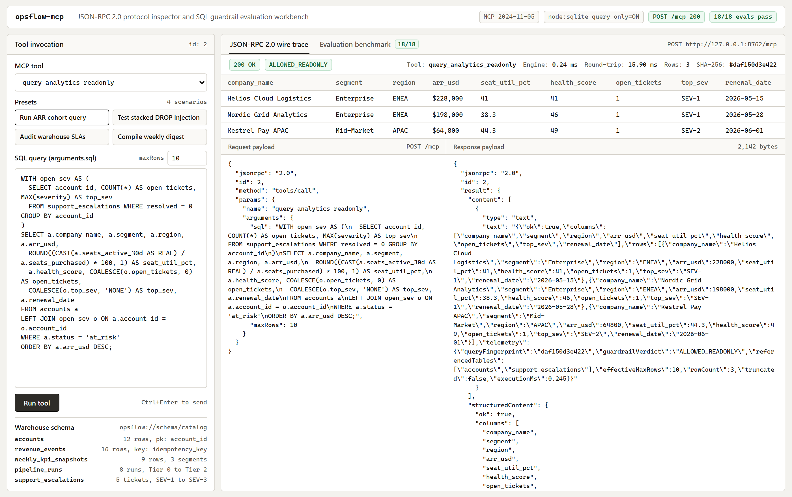
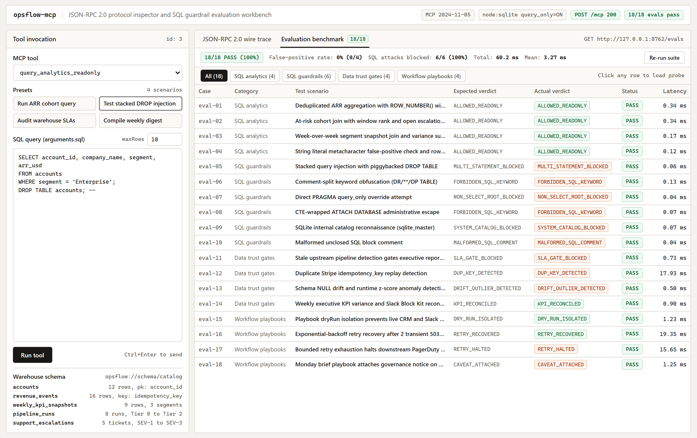

# opsflow-mcp

[](https://github.com/Nasim-U/opsflow-mcp/actions/workflows/ci.yml)

`opsflow-mcp` is a zero-dependency Model Context Protocol (MCP `2024-11-05`) server in Node.js (`node:sqlite`, `node:http`, `node:test`). It exposes a read-only B2B SaaS SQL warehouse, dataset freshness and duplicate-key checks, weekly KPI variance digests, multi-step operational playbooks, and an 18-case JSON-RPC evaluation suite.



## Quick start

Run `opsflow-mcp` on Node.js 22.5 or newer (including Node.js 24). No `npm install` step is needed because the server uses only built-in Node.js modules.

```bash
git clone https://github.com/Nasim-U/opsflow-mcp.git
cd opsflow-mcp

# Start the HTTP JSON-RPC server and browser workbench on port 8762
node src/cli.mjs serve-http --port 8762

# Run the 18-case evaluation suite
npm run eval

# Run the unit and integration test suite
npm test

# Run the terminal protocol trace
node src/cli.mjs demo

# Start the stdio transport for Claude Desktop, Antigravity, or Cursor
node src/cli.mjs serve-stdio
```

When `serve-http` is active, open `http://127.0.0.1:8762/` in a browser to run tools, inspect raw JSON-RPC 2.0 request and response payloads, and execute the evaluation suite.

## Evaluation benchmark

`src/evals.mjs` (and `GET /evals`) executes 18 deterministic cases through `mcp.handleRequest` against the seeded SQLite warehouse. Every case checks exact numeric outputs or guardrail error codes and records execution time in milliseconds.



| Category | Cases | What the suite verifies |
| :--- | ---: | :--- |
| SQL analytics | 4 | `ROW_NUMBER()` deduplication CTEs (`$234,200` verified ARR vs `$255,800` raw), `RANK()` cohort joins, week-over-week snapshot sums, and zero false positives when SQL keywords appear inside quoted string literals. |
| SQL guardrails | 6 | Blocks stacked `DROP TABLE` queries, inline comment-split keywords (`DR/**/OP`), `PRAGMA query_only = OFF`, CTE-wrapped `ATTACH DATABASE`, `sqlite_master` catalog queries, and unclosed block comments. |
| Data trust gates | 4 | Flags `revops_attribution_hourly` at `142` minutes lag (SLA `30` minutes), catches `2` duplicate Stripe `idempotency_key` rows (`$21,600` overstated ARR), detects `18.75%` NULL drift and runtime z-score outliers (`z >= 2.4`), and reconciles `compile_weekly_exec_digest`. |
| Workflow playbooks | 4 | Confirms `dryRun: true` commits `0` external writes, recovers after `2` simulated `503` timeouts with exponential backoff, halts before PagerDuty paging when retries exhaust, and attaches a governance notice when upstream checks fail. |

Run `node src/evals.mjs` from the command line to print the per-case table and exit non-zero on any regression.

## MCP tools, resources, and prompts

### Tools (`tools/list` and `tools/call`)

| Tool | Inputs | Behavior |
| :--- | :--- | :--- |
| `query_analytics_readonly` | `sql` (string), `maxRows` (`1` to `500`, default `50`) | Runs a single `SELECT` or `WITH ... SELECT` statement. Returns `columns`, `rows`, a 12-character SHA-256 `queryFingerprint`, `guardrailVerdict`, `truncated`, and `executionMs`. |
| `audit_dataset_health` | `dataset` (`all` or table name), `nullThresholdPct` (default `5`), `outlierZThreshold` (default `2.4`) | Checks pipeline freshness lag, column NULL rates, duplicate `idempotency_key` rows, and z-score outliers across `pipeline_runs` and `revenue_events`. Returns `healthScore` (`0` to `100`), `findings`, and `P0` to `P2` remediation actions. |
| `compile_weekly_exec_digest` | `targetWeek` (`YYYY-MM-DD`), `format` (`both`, `markdown`, or `slack_blocks`) | Computes week-over-week Net New ARR, Expansion ARR, Contraction and Churn ARR, pipeline coverage, p95 API latency, segment variance shares, renewal watchlist accounts, Markdown output, and Slack Block Kit JSON. |
| `run_automation_playbook` | `playbook`, `dryRun` (default `true`), `maxRetries` (`0` to `5`), `params`, `simulateTransientFailures` | Executes `churn-rescue-sync`, `monday-kpi-brief`, or `pipeline-sla-triage` with per-step retry backoff and step-level audit records. |

### Resources (`resources/list` and `resources/read`)

- `opsflow://schema/catalog` returns table grains, primary keys, business keys, PII classifications, and column types for `accounts`, `revenue_events`, `weekly_kpi_snapshots`, `pipeline_runs`, and `support_escalations`.
- `opsflow://sla/latest` returns Tier-0, Tier-1, and Tier-2 freshness targets and live pipeline compliance calculated from `pipeline_runs`.
- `opsflow://audit/recent` returns the latest 50 JSON-RPC tool calls, guardrail verdicts, query hashes, and latencies from the in-memory ring buffer.

### Prompts and agent skills

- MCP prompts (`prompts/get`): `executive-variance-brief`, `incident-root-cause-triage`, and `churn-save-plan`.
- [`skills/warehouse-analyst/SKILL.md`](./skills/warehouse-analyst/SKILL.md) defines the schema lookup, `idempotency_key` deduplication CTE, and citation sequence for ad-hoc SQL questions.
- [`skills/weekly-ops-digest/SKILL.md`](./skills/weekly-ops-digest/SKILL.md) gates weekly executive reporting on `audit_dataset_health` before compiling variances or staging `dryRun` playbook runs.

## Read-only SQL controls

`executeGuardrailedQuery` in `src/sql-guardrails.mjs` and `createOpsWarehouse` in `src/warehouse.mjs` enforce five checks on every query:

1. **Comment and literal scanner.** Strips `--` line comments and `/* ... */` block comments, rejects unclosed comments or string literals, replaces `'...'` string contents with placeholders before tokenizing, and collapses inline `/*...*/` sequences inside identifiers to catch split keywords such as `DR/**/OP`.
2. **Single-statement check (`MULTI_STATEMENT_BLOCKED`).** Allows one optional trailing semicolon and rejects any interior semicolon.
3. **Root and keyword allowlist (`NON_SELECT_ROOT_BLOCKED` and `FORBIDDEN_SQL_KEYWORD`).** Requires a `SELECT` or `WITH ... SELECT` statement and blocks `INSERT`, `UPDATE`, `DELETE`, `DROP`, `ALTER`, `TRUNCATE`, `CREATE`, `REPLACE`, `ATTACH`, `DETACH`, `PRAGMA`, `VACUUM`, `REINDEX`, `LOAD_EXTENSION`, and transaction statements.
4. **Catalog block and cursor row cap (`SYSTEM_CATALOG_BLOCKED`).** Blocks `sqlite_master` and `sqlite_schema` queries and steps `stmt.iterate()` up to `effectiveMaxRows` (hard cap `500`).
5. **SQLite engine lock.** Sets `PRAGMA trusted_schema = OFF` and `PRAGMA query_only = ON` after seeding the in-memory database so SQLite rejects writes even if called directly.

## Host configuration and HTTP API

To register `opsflow-mcp` in Claude Desktop, Google Antigravity, or Cursor, add the stdio command to `mcpServers`:

```json
{
  "mcpServers": {
    "opsflow-mcp": {
      "command": "node",
      "args": ["/absolute/path/to/opsflow-mcp/src/cli.mjs", "serve-stdio"]
    }
  }
}
```

When running `node src/cli.mjs serve-http --port 8762`, the HTTP server exposes four routes on `127.0.0.1`:

- `GET /` serves the browser protocol inspector and evaluation workbench.
- `GET /evals` runs the 18-case benchmark suite and returns the JSON report.
- `GET /health` returns server status, MCP protocol version, and registered capability counts.
- `POST /mcp` accepts single or batch JSON-RPC 2.0 requests (up to 1 MB).

```bash
curl -s http://127.0.0.1:8762/mcp \
  -H "Content-Type: application/json" \
  -d '{
    "jsonrpc": "2.0",
    "id": 1,
    "method": "tools/call",
    "params": {
      "name": "audit_dataset_health",
      "arguments": { "dataset": "all" }
    }
  }'
```

## Repository layout

```text
opsflow-mcp/
├── .github/workflows/ci.yml          # Node 24 CI: PNG check, tests, evals, CLI demo
├── docs/
│   ├── eval-suite.png                # 2x screenshot of the 18-case benchmark view
│   └── mcp-inspector.png             # 2x screenshot of the JSON-RPC 2.0 workbench
├── skills/
│   ├── warehouse-analyst/SKILL.md    # Ad-hoc SQL and deduplication workflow skill
│   └── weekly-ops-digest/SKILL.md    # Weekly KPI brief and SLA gate skill
├── src/
│   ├── ui/
│   │   └── workbench.mjs             # Browser protocol inspector HTML and client JS
│   ├── cli.mjs                       # CLI entrypoint (demo, eval, serve-stdio, serve-http)
│   ├── evals.mjs                     # 18-case deterministic MCP benchmark runner
│   ├── exec-digest.mjs               # WoW KPI variance and Slack Block Kit compiler
│   ├── health-audit.mjs              # Freshness, NULL drift, dup-key, and z-score checks
│   ├── mcp-server.mjs                # JSON-RPC 2.0 server for stdio and HTTP transports
│   ├── playbooks.mjs                 # Multi-step workflow runner with retry backoff
│   ├── sql-guardrails.mjs            # Lexical SQL scanner and row-capped query runner
│   └── warehouse.mjs                 # Seeded B2B SaaS node:sqlite warehouse
├── tests/
│   └── opsflow.test.mjs              # Protocol, security, HTTP workbench, and eval tests
├── LICENSE                           # MIT License
└── package.json                      # Native ESM package configuration
```

## Author

Nasim Uddin ([@Nasim-U](https://github.com/Nasim-U))
